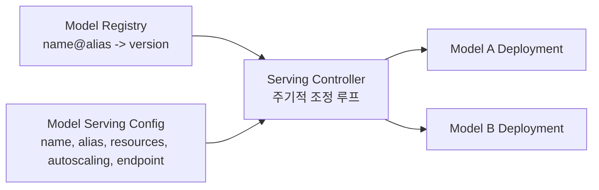

# 추천 모델 서빙 플랫폼

추천 지면과 A/B 실험이 늘면 랭킹 모델 수도 늘어난다. 모델 서빙 플랫폼은 여러 모델을 어떤 배포 단위로 나누고, 어떤 버전을 어디에 올릴지를 누가 결정하며, 운영 상태를 어떻게 확인하는지를 정하는 계층이다. 하나의 요청이 쓰는 모델, 특징과 정책의 호환 묶음은 [[Recommendation-System-Serving-Operations#Serving Bundle 계약|Serving Bundle]]이 맡고, 이 문서는 개별 모델 서버의 배포와 운영을 다룬다.

## 여러 모델이 서버 하나를 공유할 때의 한계

모델 저장소를 주기적으로 동기화하는 sidecar와 TF Serving 같은 프레임워크 전용 서빙 서버 하나로 시작하면 구성은 단순하다. 모델이 늘면 다음 문제가 함께 커진다.

- **확장 단위:** 트래픽이 큰 모델 하나 때문에 같은 서버의 모든 모델을 함께 늘려야 한다.
- **설정 분산:** 모델 경로, 버전과 리소스 설정이 여러 곳에 흩어져 지금 무엇이 배포됐는지 한곳에서 볼 수 없다.
- **장애 격리:** 한 프로세스에 여러 모델이 있으면 오류와 지연의 원인을 모델별로 나누기 어렵다.
- **프레임워크 고정:** 서버가 한 프레임워크 형식만 받으면 다른 프레임워크의 모델을 추가할 때 서빙 경로를 따로 만들어야 한다.

## 모델별 배포와 레지스트리 기반 조정

해결 방향은 모델마다 독립 배포 단위를 두고, 배포할 버전은 사람이나 학습 파이프라인이 모델 레지스트리의 alias로 지정하게 하는 것이다.

- **배포 대상은 alias로 가리킨다:** MLflow Model Registry의 alias는 특정 모델 버전을 가리키는 이름 있는 가변 참조이며 `models:/MyModel@champion` 형태의 URI로 쓸 수 있다. Alias를 옮긴다고 실행 중인 서버가 바로 바뀌지는 않고, 아래 controller가 alias를 다시 조회해 배포를 갱신할 때 서빙이 바뀐다.
- **조정 루프:** Kubernetes controller가 모델별 설정에 적힌 alias를 레지스트리에서 주기적으로 조회해 실제 버전과 다르면 해당 모델의 배포만 갱신한다. 원하는 상태를 레지스트리와 설정에 두고 클러스터를 그 상태로 맞추는 방식이라 배포 경로가 하나로 모인다. 비용은 조회 주기만큼의 반영 지연이고, controller를 단일 인스턴스로 두면 배포 경로의 단일 장애점이 된다. 복제본을 두고 Lease로 leader를 뽑아 하나만 동작하게 할 수 있지만 레지스트리는 여전히 배포 경로에 남는다.
- **모델 하나에 설정 하나:** 모델 이름, 대상 alias, 리소스, autoscaling과 endpoint를 한 항목에 모아 모델별로 확장하고 인스턴스 유형을 고른다. 요청당 연산량, 배치 가능성과 지연 목표에서 처리량당 비용이 낮은 인스턴스를 부하 시험으로 고른다.
- **프레임워크는 런타임으로 분리한다:** TensorFlow 모델은 TF Serving, PyTorch 모델은 별도 런타임처럼 서빙 서버는 달라도 controller와 설정 계약은 같게 둔다. TorchServe 저장소는 2025-08-07 보관(archived)됐고 README가 보안 수정을 포함한 추가 패치가 없다고 안내하므로(2026-10-27 확인) 새 PyTorch 서빙 기반으로는 유지보수 상태부터 확인한다.

## 배포 안정성과 되돌리기

- **Readiness:** Rolling update와 readiness probe로 새 버전이 요청을 받을 준비가 된 뒤에만 트래픽을 넘긴다. Readiness probe가 실패한 Pod는 Service의 EndpointSlice에서 빠지므로 probe는 프로세스 기동이 아니라 모델 로드와 응답 가능 여부를 확인한다.
- **목표와 실제:** 레지스트리 alias는 배포 목표 버전이고, 실제로 반영된 버전과 시각은 controller가 노출한 상태로 확인한다. Rollout이 진행되지 못하면 Deployment controller가 새 ReplicaSet 확장을 멈춰 이전 버전이 계속 응답하는데, alias는 이미 새 버전을 가리킬 수 있다. 되돌리기 전후에는 두 값이 일치하는지 본다.
- **모델 rollback:** 모델 단독 문제는 alias를 이전 버전으로 옮겨 되돌릴 수 있지만, 조회 주기와 rolling update 시간이 걸려 원자적이지 않다. Controller나 레지스트리가 멈추면 이 경로도 멈추므로 Deployment를 직접 이전 revision으로 되돌리거나 설정에 버전을 고정하는 비상 경로를 둔다. 직접 되돌린 배포는 controller가 돌아오면 alias 기준으로 다시 덮어쓰므로 alias도 함께 맞춘다.

### Serving Bundle과 맞추기

모델별 endpoint 하나에서 alias를 옮기면 rolling update 동안 이전 버전과 새 버전이 함께 응답한다. Kubernetes Deployment는 기본 설정에서 원하는 Pod 수의 75% 이상을 유지하며 최대 125%까지 띄운다. 요청마다 하나의 manifest를 pin하는 [[Recommendation-System-Serving-Operations#Serving Bundle 계약|Serving Bundle]]과 맞추려면 다음을 정한다.

- Bundle manifest는 alias가 아니라 해석된 불변 모델 버전을 가리킨다. 버전별 Deployment나 endpoint를 두거나 응답에 실제 모델 버전을 담는다.
- Alias를 제자리에서 옮기는 것은 새 버전이 현재 bundle과 호환될 때(같은 feature schema와 embedding 공간)만 허용하고, 해석된 버전을 고정한 새 bundle로 기록하며 각 요청에 실제로 응답한 모델 버전을 남긴다.
- 제자리 alias 이동은 이미 [[Recommendation-System-Serving-Operations#Rollout, Replay와 Rollback|rollout 단계]] 전체(offline 평가와 replay, shadow, 버전을 고정한 별도 Deployment에서의 canary, 실험 승급 게이트)를 통과한 버전에만 쓴다. Rolling update는 hold window도, 지표 게이트도, 실험 배정 기록도 없어 그 자체로 canary가 될 수 없으므로, 게이트를 거치지 않은 버전은 버전을 고정한 별도 Deployment를 bundle variant로 올려 검증한 뒤에만 alias를 옮긴다. 학습 파이프라인이 alias를 자동으로 옮기게 두면 이 조건을 우회한다.
- 제자리 이동 경로에서는 bundle을 바꿔도 모델이 되돌아가지 않는다. 모델 rollback은 위 alias 이동으로 하거나, 원자적이어야 하면 이전 버전 Deployment를 유지해 둔다. Decision replay와 감사는 bundle의 버전이 아니라 요청별로 기록한 실제 응답 모델 버전을 기준으로 한다.
- 원자적 전환이 필요하거나 특징 정의, embedding 공간이 바뀐 변경은 alias 이동이 아니라 [[Recommendation-System-Serving-Operations#Rollout, Replay와 Rollback|bundle 단위 rollout과 rollback]]으로 다룬다. 모델만 되돌려서는 이런 변경이 복구되지 않는다.

## 운영 관측과 비용

- 모델과 버전별로 트래픽, 리소스 사용량과 클라우드 비용을 한 대시보드에서 보고, 새 모델을 붙인 직후 정상 동작을 바로 확인한다. APM의 요청 지표와 애플리케이션의 커스텀 메트릭을 같은 모델 식별자로 묶는다.
- 모델별 배포는 서버마다 고정 오버헤드를 더한다. 분리 이득이 이 비용보다 큰지는 부하 시험과 리소스 튜닝으로 확인하고, 모델별 비용이 보이면 최적화 대상을 고르기 쉬워진다.
- 배포 상태를 로그에서 추측하지 않도록 controller가 반영한 alias, 버전과 시각을 상태로 노출하고 실패를 on-call 알림에 연결한다.

## 사례

오늘의집 추천팀은 TF Serving의 Model Loader와 S3 동기화 sidecar가 모든 모델을 한 Service에 올리던 구성에서, 모델별 배포와 MLflow alias를 조회하는 단순한 polling controller로 옮겼다. 모델 서버는 계속 TF Serving이고, controller가 대신한 것은 Model Loader와 sidecar의 갱신 역할이다. 2024-08 출시 뒤 요청량이 40% 늘었지만 안정적으로 운영됐고, 모델별 분리의 오버헤드에도 지속적인 부하 시험과 튜닝으로 총 운영 비용을 이전 대비 60% 줄였다고 보고했다. 부하가 낮은 모델에 CPU, 높은 모델에 GPU 인스턴스를 고를 수 있었던 점을 절감 요인으로 꼽았고, 레지스트리 연동으로 서빙 중인 버전 파악과 모델 rollback이 쉬워졌다고 밝혔다. PyTorch 모델은 TorchServe 기반 플랫폼으로 2025-02부터 서빙했는데, 이 저장소는 이후 2025-08-07 보관됐다. 수치는 2025-03 게시 기준 작성 팀의 보고이며 지연 시간 분포나 비용 산정 기준은 공개되지 않았다.

## 체크포인트

- 모델이 늘 때 확장, 설정, 장애 격리와 프레임워크 중 무엇이 먼저 병목이 되는가
- 배포할 버전을 누가 결정하고, 그 결정이 클러스터에 반영되는 경로가 하나인가
- 모델 rollback으로 충분한 변경과 bundle rollback이 필요한 변경을 구분하는가

## 출처

- [개인화 추천 시스템 3, 모델 서빙 — 오늘의집](https://www.bucketplace.com/post/2025-03-14-%EA%B0%9C%EC%9D%B8%ED%99%94-%EC%B6%94%EC%B2%9C-%EC%8B%9C%EC%8A%A4%ED%85%9C-3-%EB%AA%A8%EB%8D%B8-%EC%84%9C%EB%B9%99/)
- [MLflow, Model Registry](https://mlflow.org/docs/latest/ml/model-registry/)
- [TorchServe — GitHub, pytorch](https://github.com/pytorch/serve)
- [Kubernetes, Controllers](https://kubernetes.io/docs/concepts/architecture/controller/)
- [Kubernetes, Leases](https://kubernetes.io/docs/concepts/architecture/leases/)
- [Kubernetes, Deployments](https://kubernetes.io/docs/concepts/workloads/controllers/deployment/)
- [Kubernetes, Liveness, Readiness, and Startup Probes](https://kubernetes.io/docs/concepts/configuration/liveness-readiness-startup-probes/)

## 관련 문서

- [[Recommendation-System-Serving-Operations|추천 시스템 서빙과 운영]]
- [[Recommendation-System-Contracts|추천 시스템 운영 계약]]
- [[Model-Feedback-Loop-and-Validation|모델 피드백 루프와 검증]]
