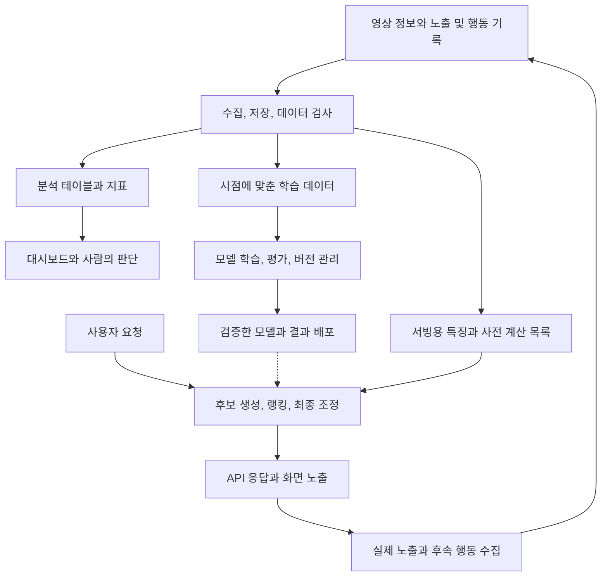

# 분석과 머신러닝의 데이터 인프라

데이터 인프라는 데이터를 모으고 정리해 여러 소비자에게 공급한다. 추천시스템은 그 데이터를 이용해 사용자에게 보여줄 항목을 결정하고, 반응을 다시 데이터로 남기는 소비자이자 생산자다. 저장 기술의 구분은 [[Data-Infrastructure-Layers|계층과 계약]], 추천 판단의 세부 구조는 [[Recommendation-System-Architecture|추천시스템 지식 지도]]를 따른다.

## 결과를 누가 사용하는가

분석용 시스템은 사람이 판단할 근거를 만들고, 운영용 데이터 시스템은 서비스 기능에 계산 결과를 공급한다. 여기서 운영용이라는 말은 OLTP 데이터베이스만을 뜻하지 않는다.

| 구성 유형 | 중심 작업 | 결과의 예 |
| --- | --- | --- |
| BI | 원천 복제, 웨어하우스, SQL 변환과 지표 계산 | 매출 대시보드 |
| 다양한 데이터 처리 | 공통 저장소에 여러 처리 엔진 연결 | SQL 분석과 대량 데이터 가공 |
| ML | 학습 데이터 준비, 실험, 모델 검증과 운영 | 추천 점수와 예측 |

이 세 유형은 함께 사용할 수 있다. 다양한 데이터 처리는 이미지와 텍스트를 결합하는 멀티모달 모델만을 뜻하지 않는다. 저장소를 공유해도 매출 계산과 학습 입력의 정의까지 같아지지는 않는다.

지표 계층은 매출 같은 계산 정의를 공유한다. Reverse ETL은 분석 결과를 CRM 같은 업무 시스템에 전달한다. 데이터 탐색과 관측 도구는 필요한 자료를 찾고 품질 이상을 확인하도록 돕는다.

공통 데이터 기반 위에 여러 응용을 붙이면 개별 연동 부담을 줄일 수 있지만 플랫폼 의존성도 커질 수 있다. 이는 플랫폼화의 효과를 설명하는 가설이며, 특정 사업자의 시장 지배나 OLTP 대체를 보장하지 않는다.

## 추천시스템에 연결한 전체 흐름

다음은 영상 서비스를 가정한 학습용 구성이다. 박스 하나가 제품이나 서버 하나를 의미하지 않는다.

학습 경로는 과거 데이터로 모델을 만들고 평가한다. 서빙 경로는 배포한 모델, 사전 계산 결과와 요청 시점의 입력을 이용한다. 사용자 요청마다 전체 데이터를 다시 학습하지 않는다. 인기 목록이나 항목 간 유사도를 미리 계산하는 구성도 가능하다.

후보 생성은 검토할 대상을 줄이고, 랭킹은 후보의 순서를 계산한다. 최종 조정은 중복, 다양성과 노출 조건을 반영한다. 세부 단계는 [[Recommendation-System-Architecture]], 온라인과 오프라인의 연결은 [[Recommendation-System-Serving-Operations]]에서 다룬다.

## 원본 데이터와 모델 입력 사이

| 대상 | 예 | 구분할 책임 |
| --- | --- | --- |
| 원본 이벤트 | 영상 노출, 재생, 좋아요 | 실제 관측, 중복과 누락 |
| 특징(feature) | 최근 7일 장르별 시청 횟수 | 계산 기준, 시점과 결측 처리 |
| 학습 목표(label) | 노출 뒤 일정 기간 내 시청 여부 | 결과 관측 기간과 의미 |
| 모델 | 특징으로 점수를 계산하는 학습 결과 | 입력 형식과 학습 버전 |
| 서빙 결과 | 사용자에게 보여줄 영상 목록 | 지연, 가용성과 최종 노출 |

특징 저장소(feature store)는 학습과 서빙에 쓰는 특징의 정의와 조회를 관리하는 선택적 구성 요소다. Feast는 과거 특징을 조회해 학습 자료를 만들거나 배치 점수를 계산하는 경로와, 온라인 예측에 필요한 특징을 조회하는 경로를 구분한다. 특징 저장소 자체가 추천 모델을 학습하거나 최종 목록을 결정하지는 않는다.

월요일의 행동을 예측할 때 수요일까지의 시청 횟수를 입력하면 미래 정보가 섞인다. 학습 당시 알 수 있었던 값과 현재 서빙에 필요한 최신 값을 구분한다. 학습에서는 7일, 서빙에서는 30일을 집계하면 이름이 같아도 입력의 의미가 달라진다. 관련 계약은 [[Recommendation-System-Serving-Operations#Freshness와 Point-in-time correctness]]를 따른다.

## 저장 기술과 모델 운영의 경계

Parquet는 데이터 파일의 표현, Iceberg와 Delta Lake는 파일 묶음의 테이블 상태, 카탈로그는 메타데이터 조회를 맡는다. 어떤 영상이 적합한지 계산하는 알고리즘과는 별도다. 상세 내용은 [[Data-Lake-Table-Formats]]를 따른다.

모델 운영에서는 입력 데이터 검사, 기존 방식과의 성능 비교, API 호환성, 배포 후 품질 관측을 함께 다룬다. 데이터 버전뿐 아니라 가공 코드, 모델과 평가 조건도 남겨야 결과를 비교할 수 있다. 테이블 스냅샷만 보존했다고 모델 실험 전체가 재현되지는 않는다.

작은 학습용 구성은 CSV, Python/pandas, 간단한 모델과 평가 코드로도 이 경계를 경험할 수 있다. 별도 특징 저장소, 분산 처리와 자동 재학습은 공유 수요, 데이터 규모나 갱신 요구가 생겼을 때 검토한다. 대규모 제품 구성을 기초 구현의 선행조건으로 삼지 않는다.

## 확인 범위

- a16z 페이지는 게시일을 2020-10-15로 표시하면서 본문을 2020년 최초 글의 개정본이라고 안내한다. 정확한 개정일은 확인하지 못했다. 시장과 제품 지도는 당시 관찰로 취급하며 2026년 채택률이나 우열의 근거로 사용하지 않는다.
- 2026-11-02에 공개 본문을 읽고 개념을 정리했다. 이미지 도표의 제품 배치와 연결선은 별도 시각 검증하지 않았다. 위 도식은 추천시스템 설명을 위해 구성한 예시다.
- Google Cloud와 Feast 공식 문서로 모델 검증, 선택적 특징 저장소와 특징 조회 경로를 대조했다. 실제 파이프라인과 제품 API를 실행한 기록은 아니다.

## 출처

- [Emerging Architectures for Modern Data Infrastructure — a16z](https://a16z.com/emerging-architectures-for-modern-data-infrastructure/)
- [Google Cloud, MLOps: Continuous delivery and automation pipelines in machine learning](https://docs.cloud.google.com/architecture/mlops-continuous-delivery-and-automation-pipelines-in-machine-learning)
- [Feast, Feature retrieval](https://docs.feast.dev/getting-started/concepts/feature-retrieval)
- [Google for Developers, Recommendation systems overview](https://developers.google.com/machine-learning/recommendation/overview/types)

## 관련 문서

- [[Data-Infrastructure-Layers|데이터 인프라의 계층과 계약]]
- [[Data-Lake-Table-Formats|데이터 레이크의 파일, 테이블과 카탈로그]]
- [[Recommendation-System-Architecture|추천시스템 지식 지도]]
- [[Recommendation-System-Serving-Operations|추천시스템 서빙과 운영]]
- [[Recommendation-System-Feedback-Data|노출과 행동의 데이터 해석]]
- [[Recommendation-System-Evaluation-Experimentation|추천시스템 평가와 실험]]
