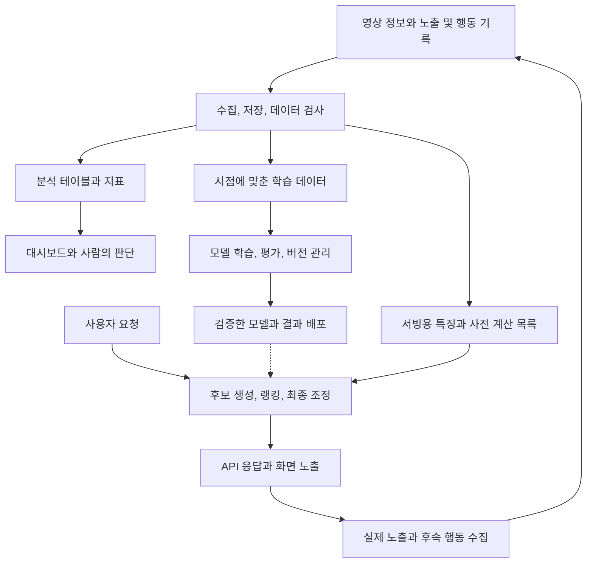

# 분석과 머신러닝의 데이터 인프라

데이터 인프라는 데이터를 모으고 정리해 여러 소비자에게 공급한다. 추천시스템은 그 데이터를 이용해 사용자에게 보여줄 항목을 결정하고, 반응을 다시 데이터로 남기는 소비자이자 생산자다. 저장 기술의 구분은 [[Data-Infrastructure-Layers|계층과 계약]], 추천 판단의 세부 구조는 [[Recommendation-System-Architecture|추천시스템 지식 지도]]를 따른다.

## 결과를 누가 사용하는가

분석용 시스템은 사람이 판단할 근거를 만들고, 운영용 데이터 시스템은 서비스 기능에 계산 결과를 공급한다. 여기서 운영용이라는 말은 OLTP 데이터베이스만을 뜻하지 않는다.

| 구성 유형 | 중심 작업 | 결과의 예 |
| --- | --- | --- |
| BI | 원천 복제, 웨어하우스, SQL 변환과 지표 계산 | 매출 대시보드 |
| 다양한 데이터 처리 | 공통 저장소에 여러 처리 엔진 연결 | SQL 분석과 대량 데이터 가공 |
| ML | 학습 데이터 준비, 실험, 모델 검증과 운영 | 추천 점수와 예측 |

이 세 유형은 함께 사용할 수 있다. 다양한 데이터 처리는 이미지와 텍스트를 결합하는 멀티모달 모델만을 뜻하지 않는다. 저장소를 공유해도 매출 계산과 학습 입력의 정의까지 같아지지는 않는다.

지표 계층은 매출 같은 계산 정의를 공유한다. Reverse ETL은 분석 결과를 CRM 같은 업무 시스템에 전달한다. 데이터 탐색과 관측 도구는 필요한 자료를 찾고 품질 이상을 확인하도록 돕는다.

공통 데이터 기반 위에 여러 응용을 붙이면 개별 연동 부담을 줄일 수 있지만 플랫폼 의존성도 커질 수 있다. 이는 플랫폼화의 효과를 설명하는 가설이며, 특정 사업자의 시장 지배나 OLTP 대체를 보장하지 않는다.

## 추천시스템에 연결한 전체 흐름

다음은 영상 서비스를 가정한 학습용 구성이다. 박스 하나가 제품이나 서버 하나를 의미하지 않는다.

학습 경로는 과거 데이터로 모델을 만들고 평가한다. 서빙 경로는 배포한 모델, 사전 계산 결과와 요청 시점의 입력을 이용한다. 사용자 요청마다 전체 데이터를 다시 학습하지 않는다. 인기 목록이나 항목 간 유사도를 미리 계산하는 구성도 가능하다.

후보 생성은 검토할 대상을 줄이고, 랭킹은 후보의 순서를 계산한다. 최종 조정은 중복, 다양성과 노출 조건을 반영한다. 세부 단계는 [[Recommendation-System-Architecture]], 온라인과 오프라인의 연결은 [[Recommendation-System-Serving-Operations]]에서 다룬다.

## 원본 데이터와 모델 입력 사이

| 대상 | 예 | 구분할 책임 |
| --- | --- | --- |
| 원본 이벤트 | 영상 노출, 재생, 좋아요 | 실제 관측, 중복과 누락 |
| 특징(feature) | 최근 7일 장르별 시청 횟수 | 계산 기준, 시점과 결측 처리 |
| 학습 목표(label) | 노출 뒤 일정 기간 내 시청 여부 | 결과 관측 기간과 의미 |
| 모델 | 특징으로 점수를 계산하는 학습 결과 | 입력 형식과 학습 버전 |
| 서빙 결과 | 사용자에게 보여줄 영상 목록 | 지연, 가용성과 최종 노출 |

특징 저장소(feature store)는 학습과 서빙에 쓰는 특징의 정의와 조회를 관리하는 선택적 구성 요소다. Feast는 과거 특징을 조회해 학습 자료를 만들거나 배치 점수를 계산하는 경로와, 온라인 예측에 필요한 특징을 조회하는 경로를 구분한다. 특징 저장소 자체가 추천 모델을 학습하거나 최종 목록을 결정하지는 않는다.

월요일의 행동을 예측할 때 수요일까지의 시청 횟수를 입력하면 미래 정보가 섞인다. 학습 당시 알 수 있었던 값과 현재 서빙에 필요한 최신 값을 구분한다. 학습에서는 7일, 서빙에서는 30일을 집계하면 이름이 같아도 입력의 의미가 달라진다. 관련 계약은 [[Recommendation-System-Serving-Operations#Freshness와 Point-in-time correctness]]를 따른다.

### 도메인의 설명을 계산 가능한 특징으로 바꾼다

원본 컬럼을 많이 모으는 것과 예측에 필요한 입력을 만드는 것은 다르다. 좌표로 상대 거리와 각도를 계산하듯, 도메인에서 중요하게 보는 조건을 데이터 변환으로 표현한다. 공개 사례로 NFL Completion Probability는 패스 거리와 수비수의 근접 정도 같은 특징으로 패스 성공 가능성을 추정한다. AWS의 해당 영상 시리즈는 분석가와의 특징 설계 협업과 XGBoost 선택을 설명한다. 이 사례를 모든 표 데이터에서 XGBoost가 더 낫다는 근거로 확대하지 않는다.

추천시스템에 적용하는 예로, 재생 이벤트의 단순 개수와 최근 7일 동안 특정 장르를 시청한 횟수를 구분한다. 후자를 만들려면 사용자와 콘텐츠의 연결 키, 장르 정의, 집계 구간과 예측 기준 시각이 필요하다. 작은 표본에서 원본 이벤트와 계산 결과를 대조한 뒤 모델 입력으로 사용한다(학습용 설계 제안).

### 데이터셋과 계산 정의를 함께 재사용한다

분석 결과 파일만 공유하면 다음 사용자가 같은 이름의 컬럼을 다른 의미로 해석할 수 있다. 재사용할 데이터에는 기술 컬럼명과 업무 용어의 대응, 행의 단위, 생성 코드, 추출 시점과 사용 범위를 함께 연결한다(설계 제안). 고객 단위 집계와 계약 단위 집계를 같은 키로 결합할 때는 행 수와 중복을 먼저 확인한다.

제품 사례로 Amazon DataZone의 business glossary는 업무 용어와 정의를 데이터 자산 및 컬럼에 연결한다. 이는 의미를 공유하는 메타데이터 기능이며 해당 데이터의 정확성이나 사용 권한을 자체적으로 증명하지 않는다. 분석 파일, 코드와 결과 보고서의 공유를 검토한 계기는 BizLens 공개 발표지만, 그 플랫폼이 DataZone을 사용한다고 추정하지 않는다.

### 검색용 지식과 모델 학습 데이터를 구분한다

문서를 수집해 검색 인덱스를 갱신하는 일과 모델의 매개변수를 학습하는 일은 다르다. RAG는 질의에 관련된 자료를 찾아 생성 시점의 입력에 제공한다. 지도 미세조정(supervised fine-tuning)은 입력과 정답 예제로 모델 매개변수를 조정한다. 따라서 지식 베이스 동기화를 모델 재학습 완료로 기록하지 않는다.

Amazon Bedrock Knowledge Bases의 `Retrieve`는 관련 원문 조각이나 이미지를 반환하고, `RetrieveAndGenerate`는 검색과 모델 호출을 결합해 답변과 출처를 반환한다. 검색 결과가 필요한 소비자와 생성 답변이 필요한 소비자를 분리할 수 있다. 출처 표시는 답변 검증의 단서이며 내용이 정확하다는 보장으로 취급하지 않는다(설계 점검).

추천시스템과 생성형 답변이 원본 데이터를 공유하더라도 특징 계산, 학습 데이터와 검색 인덱스의 갱신을 각각 추적한다. 어떤 자료를 언제까지 반영했는지, 어떤 모델과 평가 조건을 사용했는지를 나누어 남기는 것이 적용 제안이다. 모든 소비자가 같은 데이터 갱신 주기를 가져야 한다는 뜻은 아니다.

## 개발, 처리와 추론의 자원을 나눈다

모델 훈련에 필요한 최대 사양을 노트북 개발과 데이터 탐색 시간 내내 유지할 필요가 있는지 먼저 확인한다. 처리와 학습의 실행 단위를 분리하면 단계별 자원을 선택할 수 있지만 데이터 전달, 권한과 실행 이력을 연결하는 책임이 생긴다. 다음은 단계별 자원 분리를 위한 설계 점검이다.

| 단계 | 자원 선택 전에 확인할 것 |
| --- | --- |
| 탐색과 개발 | 작은 표본으로 반복할 수 있는지, 대기 중인 자원을 계속 유지하는지 |
| 전처리와 평가 | 입력 규모, 메모리와 I/O, 출력 데이터 및 평가 결과의 저장 위치 |
| 학습 | 알고리즘에 필요한 CPU/GPU, 학습 시간과 재시작 조건 |
| 추론 | 요청 시점의 지연 요구와 미리 계산할 수 있는 결과, 호출량의 시간대별 편차 |

SageMaker Processing은 전처리, 후처리, 특징 생성과 모델 평가를 job으로 실행하고, 완료 뒤 실행 자원을 해제하며 지정한 S3 위치에 출력을 저장한다. 학습 job은 `CreateTrainingJob`의 `ResourceConfig`로 학습 자원을 구성한다. 개발 환경의 사양을 모든 job에 그대로 적용해야 하는 계약은 아니다. 특정 고객 발표의 비용 절감률을 다른 데이터 규모나 부하에 그대로 적용하지 않는다.

## 추론 주기와 결과의 소비 시점을 연결한다

이벤트마다 즉시 계산할 결과와 일정 주기로 갱신해도 되는 결과를 구분한다. 개인화된 추론에서는 대상별 사용 가능한 입력과 모델 조건을 확인하고, 주기적 호출이 같은 시각에 몰리는지도 살핀다. 주기적으로 endpoint를 호출하는 구성과 SageMaker Batch Transform 같은 배치 추론 제품을 사용하는 구성은 별개다.

EventBridge Scheduler의 flexible time window는 설정한 시간 구간 안으로 대상 호출을 분산한다. 예를 들어 매시간 실행에 15분 구간을 설정하면 예정 시각 뒤 15분 안에 호출한다. 이 구간은 모델 계산의 완료 기한이 아니다. 적용 시에는 결과가 필요한 시각에서 호출 지연과 처리 시간을 함께 고려하고, 입력 시점과 결과 생성 시각을 남긴다(설계 제안).

SmartThings 공개 발표는 개인별 추론 주기와 호출 분산을 위한 Scheduler 활용을 설명한다. 발표의 자체 분산 알고리즘이 flexible time window를 사용했다는 근거는 확인하지 않았다. 추론 결과를 이벤트로 다시 공급할 때는 관측 이벤트와 모델 예측을 구분해 후속 학습의 정답으로 무심코 섞지 않는다(설계 제안).

## 저장 기술과 모델 운영의 경계

Parquet는 데이터 파일의 표현, Iceberg와 Delta Lake는 파일 묶음의 테이블 상태, 카탈로그는 메타데이터 조회를 맡는다. 어떤 영상이 적합한지 계산하는 알고리즘과는 별도다. 상세 내용은 [[Data-Lake-Table-Formats]]를 따른다.

모델 운영에서는 입력 데이터 검사, 기존 방식과의 성능 비교, API 호환성, 배포 후 품질 관측을 함께 다룬다. 데이터 버전뿐 아니라 가공 코드, 모델과 평가 조건도 남겨야 결과를 비교할 수 있다. 테이블 스냅샷만 보존했다고 모델 실험 전체가 재현되지는 않는다.

작은 학습용 구성은 CSV, Python/pandas, 간단한 모델과 평가 코드로도 이 경계를 경험할 수 있다. 별도 특징 저장소, 분산 처리와 자동 재학습은 공유 수요, 데이터 규모나 갱신 요구가 생겼을 때 검토한다. 대규모 제품 구성을 기초 구현의 선행조건으로 삼지 않는다.

## 확인 범위

- 2026-11-04에 Bedrock 공식 문서로 검색 API와 지도 미세조정의 차이를 부분 대조했다. 2024년 발표의 모델 목록, 출시 예정 기능, 가격과 성능 수치는 현재 사양으로 옮기지 않았고 API 실행은 하지 않았다.
- 2026-11-04에 특징 생성, 단계별 자원, 업무 용어와 추론 호출 분산을 공식 공개 자료와 대조했다. 고객 발표의 성과 수치, 현재 배포 상태와 모델 정확도는 검증하지 않았고, 예제 실행도 하지 않았다. 기존 본문 전체의 검증일은 유지한다.
- a16z 페이지는 게시일을 2020-10-15로 표시하면서 본문을 2020년 최초 글의 개정본이라고 안내한다. 정확한 개정일은 확인하지 못했다. 시장과 제품 지도는 당시 관찰로 취급하며 2026년 채택률이나 우열의 근거로 사용하지 않는다.
- 2026-11-02에 공개 본문을 읽고 개념을 정리했다. 이미지 도표의 제품 배치와 연결선은 별도 시각 검증하지 않았다. 위 도식은 추천시스템 설명을 위해 구성한 예시다.
- Google Cloud와 Feast 공식 문서로 모델 검증, 선택적 특징 저장소와 특징 조회 경로를 대조했다. 실제 파이프라인과 제품 API를 실행한 기록은 아니다.

## 출처

- [Amazon Bedrock, Retrieving information from data sources using Amazon Bedrock Knowledge Bases](https://docs.aws.amazon.com/bedrock/latest/userguide/kb-how-retrieval.html)
- [Amazon Bedrock, Customize your model to improve its performance for your use case](https://docs.aws.amazon.com/bedrock/latest/userguide/custom-models.html)
- [Going Deep: AWS + NFL Next Gen Stats, Episode 4: Completion Probability — AWS](https://aws.amazon.com/sports/nfl/going-deep/) — 특징 설계와 모델 선택 사례
- [Going Deep: AWS + NFL Next Gen Stats, Completion Probability — Amazon Web Services](https://www.youtube.com/watch?v=6y_0NGtQXz0) — 좌표의 상대 거리 변환과 도메인 협업
- [BizLens로 본 교보생명의 데이터 전략 성공 스토리 — Amazon Web Services Korea](https://www.youtube.com/watch?v=LIdzrwrOSpI) — 업무 용어, 데이터 탐색과 분석 산출물 재사용의 검토 계기
- [Amazon DataZone, Create a business glossary](https://docs.aws.amazon.com/datazone/latest/userguide/create-maintain-business-glossary.html)
- [데이터로 미래를 설계하다: 현대카드의 빅데이터 플랫폼 구축 사례 — Amazon Web Services Korea](https://www.youtube.com/watch?v=QZeoxpq17EQ) — 단계별 분석 자원과 학습 및 서빙 분리의 검토 계기
- [Amazon SageMaker AI, Data transformation workloads with SageMaker Processing](https://docs.aws.amazon.com/sagemaker/latest/dg/processing-job.html)
- [Amazon SageMaker, CreateTrainingJob](https://docs.aws.amazon.com/sagemaker/latest/APIReference/API_CreateTrainingJob.html)
- [삼성전자의 AI 기반 SmartThings 인텔리전스 플랫폼 — Amazon Web Services Korea](https://www.youtube.com/watch?v=FCxXgHeCZXY) — 주기적 추론 호출과 결과 이벤트의 검토 계기
- [EventBridge Scheduler, Configuring flexible time windows](https://docs.aws.amazon.com/scheduler/latest/UserGuide/managing-schedule-flexible-time-windows.html)
- [Emerging Architectures for Modern Data Infrastructure — a16z](https://a16z.com/emerging-architectures-for-modern-data-infrastructure/)
- [Google Cloud, MLOps: Continuous delivery and automation pipelines in machine learning](https://docs.cloud.google.com/architecture/mlops-continuous-delivery-and-automation-pipelines-in-machine-learning)
- [Feast, Feature retrieval](https://docs.feast.dev/getting-started/concepts/feature-retrieval)
- [Google for Developers, Recommendation systems overview](https://developers.google.com/machine-learning/recommendation/overview/types)

## 관련 문서

- [[Data-Infrastructure-Layers|데이터 인프라의 계층과 계약]]
- [[Data-Lake-Table-Formats|데이터 레이크의 파일, 테이블과 카탈로그]]
- [[Recommendation-System-Architecture|추천시스템 지식 지도]]
- [[Recommendation-System-Serving-Operations|추천시스템 서빙과 운영]]
- [[Recommendation-System-Feedback-Data|노출과 행동의 데이터 해석]]
- [[Recommendation-System-Evaluation-Experimentation|추천시스템 평가와 실험]]
