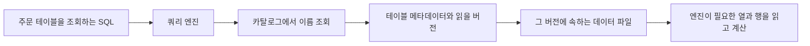

# 데이터 레이크의 파일, 테이블과 카탈로그

객체 저장소에 파일이 있다는 사실만으로 일관된 주문 테이블이 생기지는 않는다. 파일의 바이트 해석, 테이블 버전과 이름 조회를 별도 계층으로 나누면 레이크하우스의 책임이 보인다.

## 세 가지 계약

| 계층 | 예 | 책임 |
|---|---|---|
| 데이터 파일 형식 | Parquet, ORC, Avro | 한 파일 안의 스키마와 레코드 표현 |
| 테이블 형식 | Iceberg, Delta Lake | 어떤 파일이 특정 테이블 상태에 포함되는지와 변경 이력 |
| 카탈로그 | Hive Metastore, AWS Glue Data Catalog | 이름을 테이블 메타데이터와 연결 |

Parquet는 열 기반 파일 형식이다. 열 단위 읽기와 압축에 적합하지만 여러 파일을 동시에 갱신하는 트랜잭션을 파일 형식만으로 제공하지 않는다. 버킷은 객체 저장소의 구획이며 SQL 테이블이나 카탈로그와 같은 개념이 아니다.

## 파일 형식: 값을 어떻게 담고 읽는가

- **Parquet:** 주문의 상품과 금액만 집계한다면 필요한 열을 골라 읽을 수 있다. 같은 열의 비슷한 값을 모아 인코딩하고 압축하는 데 유리하다. CSV나 JSON을 Parquet로 변환해도 주문 취소 반영이나 여러 파일의 커밋까지 자동으로 해결되지는 않는다.
- **ORC:** Hive와 함께 발전한 컬럼 기반 형식이다. 필요한 열을 읽고 타입에 맞춰 인코딩하며 내부 인덱스로 읽을 범위를 줄일 수 있다. Hive 전용 형식이나 트랜잭션 자체와 같은 뜻은 아니다.
- **Avro:** 스키마로 레코드 구조를 정의하는 직렬화 형식이다. 파일 저장과 이벤트 전달에 사용할 수 있으며, Parquet와 ORC처럼 분석용 열 읽기만을 기준으로 비교하지 않는다.

Avro에서는 데이터를 쓴 쪽의 스키마와 읽는 쪽의 스키마를 대조한다. 예전 주문에 없던 `coupon_code`를 새 reader가 기대한다면, reader 스키마에 그 필드의 기본값이 있어야 기존 레코드를 읽을 때 채울 수 있다. reader가 기대하는 필드가 writer 스키마에 없고 reader에도 기본값이 없으면 오류가 난다. 기본값은 과거 파일을 다시 쓰거나 모든 스키마 변경을 호환되게 만드는 기능이 아니다. [Apache Avro, Schema Resolution](https://avro.apache.org/docs/1.12.0/specification/#schema-resolution)

## 주문 데이터를 읽는 경로

분석 엔진은 카탈로그에서 주문 테이블을 찾고, 테이블 메타데이터가 지정하는 버전을 선택한다. 그 버전에 필요한 파일과 열을 읽는다. 최근 6개월 광고 성과를 주문과 결합하려면 이 저장 구조 외에도 고객/캠페인 식별자, 주문 시점과 매출 정의가 필요하다.

객체 저장소는 파일을 보관하고, 파일 형식은 바이트의 해석을 정하며, 테이블 형식은 파일 묶음의 상태를 관리한다. 카탈로그는 이름으로 이 정보를 찾게 하고 실제 조인과 집계는 엔진이 실행한다. Iceberg가 혼자 원본 주문을 수집하거나 SQL을 실행하는 프로그램은 아니다.

## 테이블 형식: 완성된 변경을 읽는다

주문 `A-1001`의 취소를 반영하면서 데이터 파일이 교체될 수 있다. 읽는 쪽은 파일이 준비되는 중간 상태 대신 커밋된 테이블 상태를 읽어야 한다. Parquet와 Iceberg 또는 Delta Lake는 같은 역할의 대체재가 아니며 Parquet 데이터 파일을 테이블 형식으로 관리할 수 있다.

Iceberg의 스냅샷은 특정 상태를 구성하는 파일들을 메타데이터로 연결한다. 스냅샷마다 모든 데이터를 복사한다는 뜻은 아니다. Delta Lake는 트랜잭션 로그의 파일 추가와 제외 등의 동작을 해석해 테이블 상태를 구성한다. 이 로그는 고객이 주문을 취소한 이유를 적는 업무 이벤트 로그와 구분한다. 파일을 목록에서 제외하는 것과 즉시 물리 삭제하는 것도 다르다.

Iceberg의 필드 ID와 스키마 진화는 열 이름이나 위치 변화와 데이터의 정체성을 구분한다. 파티션 진화는 이전 파일을 모두 다시 쓰지 않고 새 분할 규칙을 도입할 수 있게 한다. 쿼리 엔진의 읽기/쓰기 지원과 테이블 버전은 별도로 확인한다.

Delta Lake는 데이터 레이크에 ACID 트랜잭션과 테이블 관리 계층을 제공한다. Hive ACID도 base/delta 파일과 트랜잭션 관리, compaction을 사용하는 별도 구현이다. Hive Metastore가 존재한다는 사실만으로 그 테이블이 Hive ACID가 되는 것은 아니다.

Hive의 UPDATE와 DELETE를 포함하는 ACID 테이블은 ORC 기반 설명과 구성 조건을 확인한다. 단순 INSERT와 전체 ACID 기능의 지원을 같은 것으로 확대하지 않는다. 원자성, 일관성, 격리성과 지속성은 변경 처리의 성질이며 특정 카탈로그 제품의 이름이 아니다.

## 카탈로그와 DuckLake

Hive Metastore와 AWS Glue Data Catalog는 테이블을 찾고 메타데이터를 연결하는 카탈로그의 예다. Iceberg의 읽기 경로에서는 이름으로 테이블 메타데이터를 찾아 스냅샷과 파일로 이어진다. 파일 위치가 바뀌어도 테이블 이름으로 접근할 수 있지만, 엔진과 카탈로그가 지원하는 연결 방식 및 권한은 따로 확인해야 한다.

DuckLake는 테이블 메타데이터를 SQL 데이터베이스에 두고 데이터 파일 저장 위치를 별도로 선택한다. DuckDB 확장 사용에서도 카탈로그 DB와 파일 저장소를 각각 정한다. 이름이 비슷해도 DuckDB의 모든 로컬 테이블이 DuckLake 테이블인 것은 아니다.

로컬에서는 DuckDB 카탈로그 파일과 데이터 폴더로 시작할 수 있다. 원격 클라이언트를 포함한 다중 사용자 구성에는 PostgreSQL 같은 공유 카탈로그를 선택할 수 있으며, 메타데이터를 함께 관리해도 계산은 각 엔진이 수행한다. 구체적인 동시 쓰기 조건은 [[DuckLake]]에서 다룬다.

Parquet 파일만 저장한다고 단정하면 작은 입력을 놓칠 수 있다. 현재 DuckDB 확장 안내에는 작은 삽입을 메타데이터 카탈로그에 인라인으로 저장하는 경로도 있다. SQL 메타데이터와 Parquet 데이터의 기본 구조를 이해하되 모든 INSERT가 즉시 Parquet 파일 하나를 만든다고 가정하지 않는다. [DuckLake, DuckDB Extension Introduction](https://ducklake.select/docs/stable/duckdb/introduction)

## 변경 관리 기능의 경계

| 기능 | 주문 데이터의 예 | 함께 구분할 것 |
|---|---|---|
| 타임 트래블 | 취소 반영 전 보고서가 읽었던 테이블 버전을 다시 조회 | 주문 날짜로 필터링하거나 취소를 되돌리는 작업과 다름. 해당 메타데이터와 파일이 남아 있어야 함 |
| 스키마 진화 | 배송 국가 열을 추가하거나 이름과 타입을 변경 | 허용되는 변경 범위를 확인. 과거 주문의 실제 배송 국가를 알아내는 데이터 보강은 별도 |
| 파티션 진화 | 월별 배치에서 일별 배치로 기준 변경 | Iceberg는 기존 배치를 유지하고 새 규칙으로 쓸 수 있음. 과거 파일 재작성은 별도 작업 |
| 컴팩션 | 너무 많은 작은 파일을 읽기 좋은 크기로 정리 | 논리적 데이터는 유지하는 물리적 정리. 업무상 취소나 중복의 의미를 자동 판정하지 않음 |

예를 들어 Iceberg 스냅샷을 만료하면 그 버전으로 타임 트래블할 수 없다. 아직 유효한 스냅샷이 참조하는 파일은 보존해야 하며 객체 저장소의 수명주기 정책으로 먼저 지우면 과거 조회를 깨뜨릴 수 있다. 형식마다 보존과 정리 절차가 다르므로 엔진의 실제 지원을 확인한다.

## 레이크하우스: 같은 원천을 여러 작업에 사용한다

파일 기반 레이크에 테이블 관리와 분석 기능을 결합하면 SQL 보고서와 모델 학습이 같은 바탕 데이터를 활용할 수 있다. 팀마다 원본 사본을 만들고 수정과 지연 도착을 따로 맞추는 부담을 줄이려는 접근이다. Databricks는 Delta Lake와 Iceberg를 지원하는 플랫폼의 예이며, 지원하는 테이블 유형과 기능은 개별 문서로 확인한다.

같은 주문 테이블을 읽더라도 매출 집계와 추천시스템 학습의 가공 규칙은 다를 수 있다. 취소와 환불을 어떻게 반영할지, 어느 시점까지의 기록을 사용할지, 어떤 버전을 읽었는지를 각 작업에서 정한다. 테이블 공유만으로 두 작업의 조회 시점이나 결과까지 같아지지는 않는다.

추천시스템 학습에 연결할 때는 입력 데이터 버전과 계산 기준을 재현하는 관점으로 활용할 수 있다. 이는 학습 적용 관점이며 레이크하우스 구축을 기초 모델 구현의 선행조건으로 추가하는 뜻은 아니다.

## 운영 체크포인트

- 타임 트래블에 필요한 이전 메타데이터와 파일이 보존되는가?
- snapshot 만료와 파일 정리가 진행 중인 읽기 작업을 해치지 않는가?
- 작은 파일과 삭제 데이터 누적을 compaction으로 관리하는가?
- 카탈로그 권한과 객체 저장소의 직접 읽기 권한이 맞는가?
- 엔진마다 같은 schema, partition과 delete 기능을 해석하는가?

## 확인 범위

기존에는 2026-10-29 공개된 시즌2 EP03의 발췌만 기록했다. 2026-11-02에는 영상 URL과 한국어 수동 자막 전체(13분 13초)를 확보해 읽고, 파일 형식, 변경 관리와 레이크하우스 설명을 보강했다. 공식 명세와 문서로 새 설명을 대조했으며 화면의 도식은 직접 확인하지 않았다. 다중 엔진 동시 쓰기, 성능과 복구 실습은 수행하지 않았다. 문서 정리를 사용자의 학습 완료나 현재 로드맵의 진도 통과로 처리하지 않는다.

## 출처

- [Apache Parquet, Overview](https://parquet.apache.org/docs/overview/)
- [Apache ORC, Background](https://orc.apache.org/docs/)
- [Apache Avro, Specification 1.12.0](https://avro.apache.org/docs/1.12.0/specification/)
- [Apache Iceberg, Table Specification](https://iceberg.apache.org/spec/)
- [Apache Iceberg, Evolution](https://iceberg.apache.org/docs/latest/evolution/)
- [Apache Iceberg, Maintenance](https://iceberg.apache.org/docs/latest/maintenance/)
- [Delta Lake, Documentation](https://docs.delta.io/)
- [Delta Lake, Transaction Log Protocol](https://github.com/delta-io/delta/blob/master/PROTOCOL.md)
- [Apache Hive, Hive Transactions](https://hive.apache.org/docs/latest/user/hive-transactions/)
- [DuckLake, DuckDB Extension Introduction](https://ducklake.select/docs/stable/duckdb/introduction)
- [DuckLake, Choosing a Catalog Database](https://ducklake.select/docs/stable/duckdb/usage/choosing_a_catalog_database)
- [Databricks, What is Apache Iceberg in Databricks?](https://docs.databricks.com/aws/en/iceberg/)
- [긱뉴스, 파일에서 테이블로: Parquet, Iceberg, Delta Lake와 데이터 레이크하우스, 최신 데이터 인프라 이해하기 시즌2 EP03](https://www.youtube.com/watch?v=ugvSWImjCjU) — 2026-10-29 공개, 2026-11-02 한국어 수동 자막 전체 확인

## 관련 문서

- [[Data-Infrastructure-Layers|데이터 인프라의 계층과 계약]]
- [[DuckLake|SQL 카탈로그와 Parquet]]
- [[Recommendation-System-Feedback-Data|추천시스템 피드백 데이터]]
